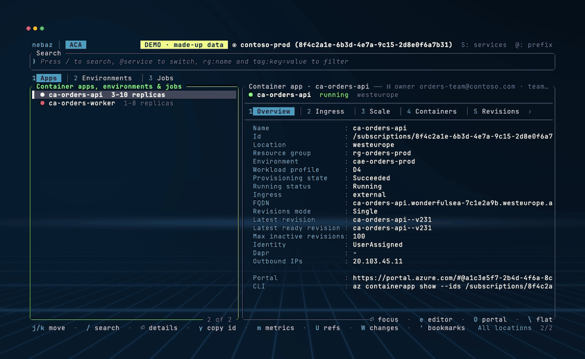
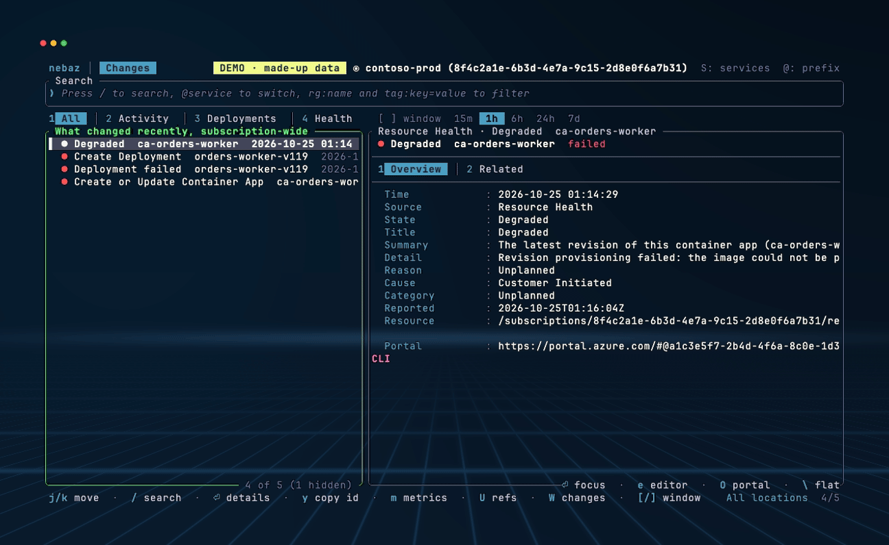
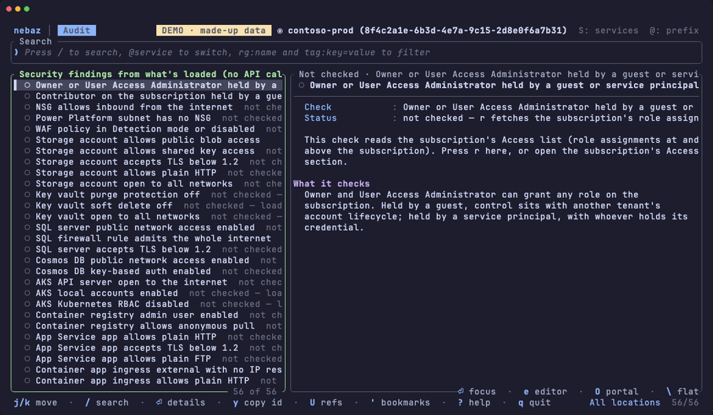
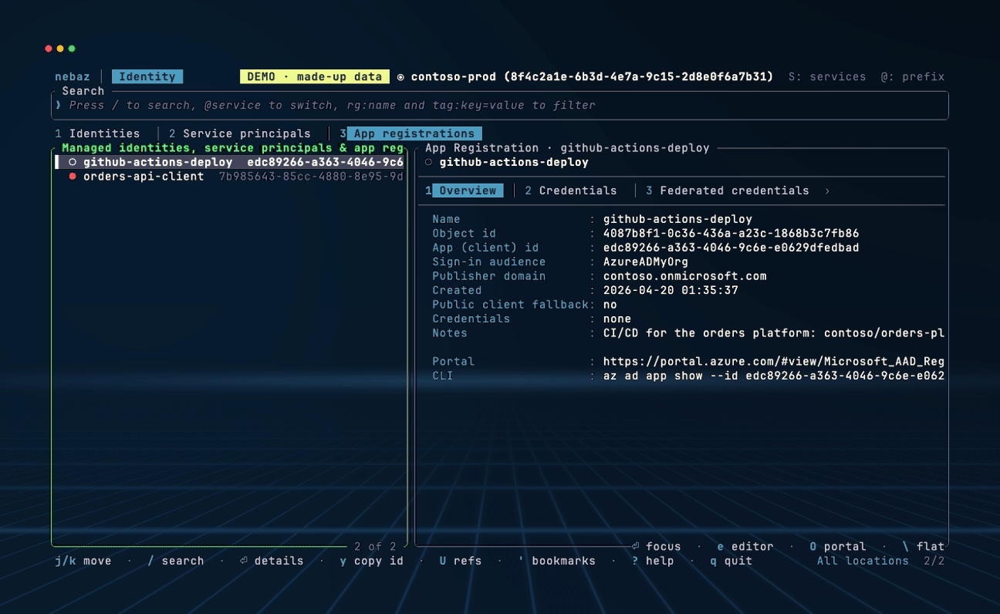
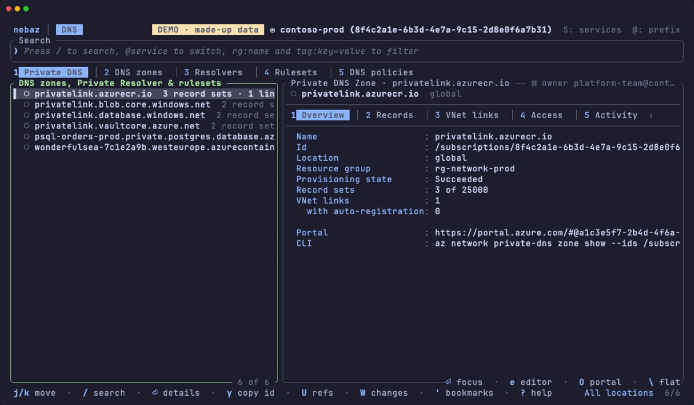
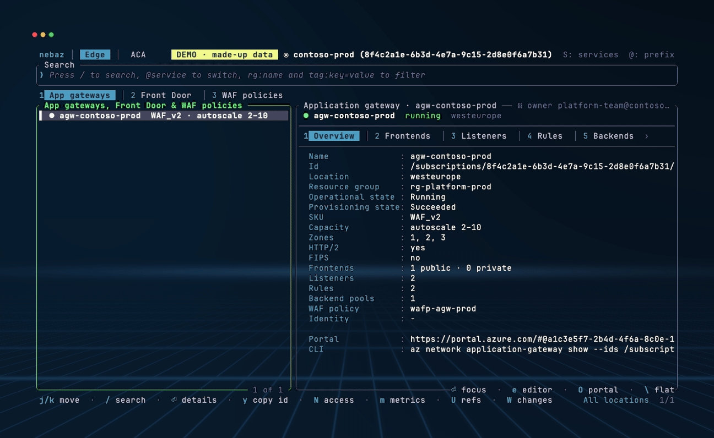

# nebaz

A fast, keyboard-driven, **read-only** terminal UI for browsing Azure: 20
services, console-style detail panes, follow-the-links navigation across
subscriptions, a network access lens, metrics, a change timeline and a
security audit, all without leaving the terminal. The Azure sibling of
[neboto](https://github.com/neboto/neboto-tui) (the AWS one).

Built in Rust with [Ratatui](https://ratatui.rs/).

<p align="center">
  
</p>

<p align="center"><em>Recorded with <code>nebaz --demo</code>. Nothing on screen is a real tenant.</em></p>

**Try it without an Azure account:** `nebaz --demo` opens a made-up tenant
with an outage to track down and misconfigurations planted for the audit to
find. It needs no `az`, no login, and makes no network calls.

**nebaz is read-only.** It issues only `GET`s, the built-in `Reader` role is
all it needs, and a test fails the build if that ever changes. See
[Why read-only](#why-read-only).

> [!WARNING]
> **nebaz is experimental.** Most services were built against Azure's API
> specs and tested offline, and have **not** had in-depth testing against
> live subscriptions. Expect missing fields, wrong labels and rough edges.
> The read-only guarantee does not depend on any of that: every layer that
> keeps nebaz from changing anything is enforced and tested. Reports from
> real tenants are very welcome.

---

## Highlights

- **20 Azure services** behind an `@prefix` fuzzy search (`@vm web`,
  `@nsg`, `@aca`), with numbered sub-tabs: about 50 lists, every one
  subscription-wide.
- **Console-style split detail panes**: overview, the type's own sections
  (loaded lazily on first view), **Access** (the role assignments that apply,
  principals named through Microsoft Graph), **Activity** (the last week of
  operations: who, what, when) and **Related**.
- **Follow the links**: `Enter` on any ARM id jumps to that resource, across
  services, resource groups and subscriptions. `⌫` comes back.
- **Network access lens** (`N`) on a VM, NIC, subnet or NSG: the NSG rules
  that apply, in priority order with defaults, shadowed rules marked.
- **Metrics** (`m`): Azure Monitor charts in the pane, a curated set per type.
- **Change timeline** (`W`) on any resource: the Activity Log, Resource Health
  and fired alerts, merged. **`@changes`** does it subscription-wide.
- **`@audit`**: over 60 checks (world-open NSG rules, subnets without an NSG,
  public storage and vaults, open SQL firewalls, expiring app credentials,
  privileged guests and service principals, VPN and ExpressRoute links down,
  firewalls with threat intelligence off, …) computed from what is already
  loaded.
- **Directory**: service principals and app registrations from Microsoft
  Graph, with credential expiry.
- **Referenced by** (`U`) and an **ownership ribbon**: what points at this
  resource, and who manages it.
- **Copy, never run**: `y` copies the id, `C` picks an `az` command to copy
  (read, connect or change); nebaz runs none of them.
- **Export** (`X` / `Ctrl-X`) to JSON, CSV and Markdown, **headless
  subcommands** for scripts and agents, **macros**, **bookmarks**, **10
  themes**, **mouse** support.

---

## See it in action

Each clip is one workflow against `nebaz --demo`. Click for full size.

<table>
  <tr>
    <td width="50%"><a href="demo/scenes/power-platform-outage.gif"></a><br><b>Why can't Power Platform reach the API?</b> <code>@changes</code> shows a new NSG rule, <kbd>W</kbd> puts it next to the alert, and <kbd>N</kbd> shows it shadowing the default allow for the injected subnet.</td>
    <td width="50%"><a href="demo/scenes/audit.gif"></a><br><b>Audit.</b> <code>@audit</code> lists what is wrong, worst first; <kbd>Enter</kbd> opens the NSG with SSH open to the internet and <kbd>W</kbd> shows the vendor's guest account added it.</td>
  </tr>
  <tr>
    <td width="50%"><a href="demo/scenes/identities.gif"></a><br><b>Who can do what.</b> An app registration with one secret expired and one expiring in six days, and a deploy service principal holding User Access Administrator on the subscription.</td>
    <td width="50%"><a href="demo/scenes/dns.gif"></a><br><b>Private DNS.</b> A private-link zone with records but no VNet link, so nothing resolves it, and which networks each zone is linked to.</td>
  </tr>
  <tr>
    <td width="50%"><a href="demo/scenes/follow-links.gif"></a><br><b>Follow the links.</b> <kbd>Enter</kbd> from an application gateway's backend to the container app, its environment and its subnet, then <kbd>N</kbd> for what may reach it.</td>
    <td width="50%"></td>
  </tr>
</table>

---

## Install

nebaz needs the **Azure CLI** (≥ 2.54.0), logged in with `az login`. The
installer does not install it.

**Installer:** picks the right binary for Linux (x86_64, aarch64) or macOS
(Intel, Apple Silicon), verifies its SHA-256 and, when the GitHub CLI is
installed, its signed build provenance, and puts it in `~/.local/bin`:

```bash
curl -fsSL https://raw.githubusercontent.com/neboto/nebaz/main/install.sh | sh
```

Prefer to read a script before running it?

```bash
curl -fsSLO https://raw.githubusercontent.com/neboto/nebaz/main/install.sh && less install.sh && sh install.sh
```

`NEBAZ_VERSION=v0.3.0` pins a version and `NEBAZ_INSTALL_DIR` changes the
destination.

**Other ways:**

```bash
cargo binstall --git https://github.com/neboto/nebaz nebaz   # cargo-binstall
cargo install --git https://github.com/neboto/nebaz          # from source, recent stable Rust
```

or download the archive for your platform from the
[releases page](https://github.com/neboto/nebaz/releases). Every archive
carries a signed build provenance attestation:

```bash
gh attestation verify nebaz-aarch64-apple-darwin.tar.gz --repo neboto/nebaz
```

---

## Quick start

```bash
az login
nebaz                 # the welcome screen; S picks a service
nebaz -s vm           # straight to virtual machines
nebaz -s nsg -r westeurope -p "Prod"   # a sub-tab, a location filter, a subscription
nebaz --demo          # the made-up tenant, no Azure needed
```

Then: `j`/`k` to move, `⏎` to open the detail pane, `1`–`9` for its
sections, `⏎` on an ARM id to jump, `⌫` to come back, `/` to search,
`@` to switch service, `?` for every key.

---

## Services

`-s <prefix>` on the command line, or `@<prefix>` in the search box. Each
service's sub-tabs have prefixes of their own (`nebaz services` lists them
all).

| Prefix | Service | Sub-tabs |
|---|---|---|
| `sub` | Subscriptions | Subscriptions, Resource groups (`rg`), All resources (`all`) |
| `vm` | Virtual Machines | VMs, Disks (`disk`), NICs (`nic`), Scale sets (`vmss`, instances lazy; a Flexible set's VMs are in VMs) |
| `storage` | Storage | Accounts (blob containers lazy) |
| `backup` | Backup | Recovery Services vaults (protected items, policies, failed jobs), Backup vaults (`bvault`: backup instances, policies, jobs) |
| `vnet` | Virtual Network | VNets, Subnets (`subnet`), NSGs (`nsg`), Public IPs (`pip`), Load balancers (`lb`), Route tables (`rt`, appliance next hops matched to their NIC / VM or load balancer), NAT gateways (`nat`), Private endpoints (`pe`), Bastion hosts (`bastion`), DDoS protection plans (`ddos`); VNets and NSGs show their Network Watcher flow logs |
| `dns` | DNS | Private DNS zones, DNS zones (`dnsz`), Private resolvers (`dnsr`), Forwarding rulesets (`dnsfr`), DNS security policies (`dnsp`), Traffic Manager profiles (`tm`, endpoints) |
| `agw` | Edge | Application gateways, Front Door (`afd`), WAF policies (`waf`), Private Link services (`pls`, consumer connections) |
| `er` | Hybrid | ExpressRoute circuits, VNet gateways (`vgw`), Connections (`cn`), Local network gateways (`lgw`) |
| `fw` | Firewall | Azure Firewalls, Firewall policies (`fwp`, rule collection groups), IP groups (`ipg`), Palo Alto Cloud NGFW (`ngfw`), Local rulestacks (`rulestack`, rules) |
| `kv` | Key Vault | Vaults (secret and key *names*, never values) |
| `id` | Identity | Managed identities, Service principals (`sp`), App registrations (`appreg`) |
| `aks` | AKS | Clusters, Node pools (`pool`) |
| `acr` | Container Registry | Registries (replications, webhooks) |
| `app` | App Service | Apps, Function apps (`func`), Plans (`plan`) |
| `sql` | SQL | Servers (databases, firewall rules) |
| `cosmos` | Cosmos DB | Accounts (databases on whichever API) |
| `pg` | PostgreSQL & MySQL | PostgreSQL flexible servers, MySQL (`mysql`) |
| `foundry` | Foundry | AI Services and Azure OpenAI accounts (deployments, projects) |
| `monitor` | Monitor | Log Analytics workspaces, App Insights (`appi`) |
| `pp` | Power Platform | Enterprise policies (VNet injection, encryption) |
| `aca` | Container Apps | Apps (revisions), Environments (`acaenv`), Jobs (`acajob`, executions) |
| `redis` | Redis | Azure Cache for Redis, Managed Redis (`amr`) |
| `sb` | Messaging | Service Bus namespaces, Event Hubs (`eh`) |
| `changes` | Changes | Everything that changed recently: activity, deployments, health |
| `audit` | Audit | Security findings over what is loaded |

What each service shows, its state rule and the calls behind it:
[`docs/SERVICES.md`](docs/SERVICES.md). Keys, credentials, connection
strings, app settings and secret values are never fetched.

---

## Keys

`?` shows them all in the app.

**Anywhere**

| Key | |
|---|---|
| `S` · `R` · `P` | service · location · subscription pickers |
| `/` · `@svc text` | fuzzy search · switch service and search |
| `⌫` / `Ctrl-O` · `` ` `` | history back · jump list |
| `B` · `'` | bookmark · bookmarks |
| `,` | macros (record, replay; `--macro NAME` on startup) |
| `M` · `b` · `?` · `q` | messages · banner · help · quit |

**List pane**

| Key | |
|---|---|
| `j`/`k` · `gg`/`G` · `^d`/`^u` | move · top/bottom · half page |
| `⏎` / `l` | open the detail pane |
| `Tab` · `1`–`9` · `H`/`L` | sub-tabs |
| `z` · `F` · `a` | sort · state filter · hide noisy rows |
| `V` · `J`/`K` · `^A` | select rows; then `y` copies a Markdown table, `X` deep-exports |
| `r` / `F5` · `w` | refresh · watch mode |

**Detail pane**

| Key | |
|---|---|
| `Tab` · `1`–`9` | sections |
| `⏎` | jump to the ARM id on the line |
| `\` · `Z` · `^W` | every section in one scroll · full width · wrap long values |
| `/` · `n`/`N` | filter the lines · step matches |
| `[[` / `]]` | previous / next group |
| `V` · `y` | select lines · copy line or selection |

**On a resource**

| Key | |
|---|---|
| `N` | network access lens (VM, NIC, subnet, NSG) |
| `m` | metrics |
| `W` | change timeline (`f` one source, `[`/`]` window) |
| `U` | referenced by |
| `C` | copy an `az` command (inspect, connect, change; never run) |
| `y` · `O` · `e` | copy the id · open in the portal · open the JSON in `$EDITOR` |
| `X` / `^X` | export the resource / the list |

**Search tokens:** `rg:name` (resource group), `tag:key=value`, and
`@* text` to search every list already loaded this session. **Mouse:**
click, double-click (`⏎`), right-click (`⌫`), drag to select, wheel to
scroll.

---

## Subscriptions and locations

- Every list is **subscription-wide**. `P` (or `-p`, by id or name) switches
  subscription, and with it tenant; the picker lists every subscription the
  Azure CLI knows. With `subscriptions = [...]` in the config, `P` also
  shows each one's row count for the current sub-tab.
- **Location** (`R`, `-r`) is a filter over rows already fetched, never a
  call scope; `global` resources pass every filter.
- **Resource group** is the `rg:<name>` search token.

---

## Scripts and agents

With a subcommand nebaz runs once and prints instead of opening the TUI:
the same read-only calls. Output is JSON (`"schema": "nebaz/v1"`) or
Markdown (`-o md`); stdout carries only the result, warnings go to stderr.

```bash
nebaz services                              # every service, its sub-tabs and their prefixes
nebaz ls vm                                 # one subscription-wide list
nebaz ls vnet/subnets -r westeurope -f 'rg:prod tag:env=prod' --limit 20
nebaz ls vm --subscriptions Prod,Dev        # several subscriptions, each row tagged
nebaz get /subscriptions/…/virtualMachines/vm-1          # every section, lazy ones fetched
nebaz get vm-1 --in vm --section access --section related
nebaz changes --since 6h                    # what changed, subscription-wide
nebaz audit --fail-on high                  # exit 3 on a finding at or above high
```

`get` shows what the detail pane shows, driving the same app without a
terminal. Exit codes: `0` ok, `1` an Azure error, `2` a wrong request, `3`
an audit finding at or above `--fail-on`, `4` not signed in. The stable
keys, flags and exit codes are pinned in
[`src/headless/contract.json`](src/headless/contract.json); an agent skill
describing all of it is in [`skills/nebaz/SKILL.md`](skills/nebaz/SKILL.md).
Every subcommand takes `--demo` too.

---

## Configuration

`~/.config/nebaz/config.toml`; every key is documented in
[`config.example.toml`](config.example.toml). Command-line flags override it
for one run.

- **Auth** is the Azure CLI: `az login`, then run nebaz (`auth = "cli"`, env
  `NEBAZ_AUTH`). A missing `az` exits with the install link; not being
  logged in opens the TUI with one status line, and `R` retries.
- **Sovereign clouds:** `endpoint_url` (`--endpoint-url`) sets the ARM base
  URL.
- **Themes:** `theme = "gruvbox-dark"` (`--theme`): dark, light,
  solarized, gruvbox, dracula, nord and catppuccin presets.
- **Recordings:** `--show-keys` names each key in a corner box as it's
  pressed, with what it did.
- **Update check:** once a day nebaz asks GitHub for its latest release and
  shows a dim `↑ vX.Y.Z` when it is newer. `update_check = false`,
  `--no-update-check` or `NEBAZ_NO_UPDATE_CHECK=1` turn it off.

---

## Why read-only

This is a design constraint, not a missing feature. A
[`PERMISSIONS.md`](PERMISSIONS.md) that documents a pure `*/read` footprint
is a trust asset: a security team can approve nebaz precisely *because* it
cannot change anything, and the built-in **Reader** role at subscription
scope is the whole requirement.

The promise is held at three layers, not by convention:

1. the single request constructor only builds `GET`s, and a pipeline policy
   refuses any other method at runtime;
2. [`tests/readonly_guard.rs`](tests/readonly_guard.rs) fails `cargo test`
   if the source gains another request builder, an HTTP client crate, a
   data-plane host (Key Vault, blob, SQL, Cosmos, model endpoints, …), a
   mutating `az` command, or a non-read action in `PERMISSIONS.md`;
3. `Reader` grants nothing a write could use.

**Key Vault** is the case people ask about: nebaz lists secret and key
**names** through ARM's control-plane actions, which never return a value,
and no vault data-plane call exists in the codebase.

**Microsoft Graph** is read the same way: `GET`s of directory objects, never
a secret ([ADR 0004](docs/adr/0004-read-only-microsoft-graph.md)).

**The one non-Azure request** is the daily update check: an anonymous `GET`
of `api.github.com/repos/neboto/nebaz/releases/latest`, no token, through
the same GET-only pipeline, allowed from one file
([ADR 0008](docs/adr/0008-update-check-is-the-one-non-azure-request.md)).

**Check it yourself.** Every request carries `nebaz azsdk-rust-nebaz/<version>`
at the front of its `User-Agent`. With Microsoft Graph activity logs in a
Log Analytics workspace, `MicrosoftGraphActivityLogs | where UserAgent
startswith "nebaz "` lists its directory reads, every one a `GET`. ARM's
Activity Log records writes only, so nebaz never appears in it.

Where a change is what you want, `C` copies the `az` command (`vm start`,
`aks get-credentials`, `containerapp exec`, …) for you to run yourself
([ADR 0005](docs/adr/0005-copied-commands-may-change-azure.md)).

---

## Development

```bash
cargo build
cargo run -- --demo                          # the offline tenant (docs/DEMO.md)
cargo test                                   # every test, the read-only guard included
cargo clippy --all-targets -- -D warnings    # CI fails on any warning
scripts/smoke.sh                             # offline pty run with a fake az (needs python3)
```

- [`CONTRIBUTING.md`](CONTRIBUTING.md): how to send a change.
- [`CLAUDE.md`](CLAUDE.md): the architecture and the conventions.
- [`docs/SERVICES.md`](docs/SERVICES.md): what each service shows and why.
- [`docs/DEMO.md`](docs/DEMO.md): the demo tenant, and how to add to it.
- [`docs/adr/`](docs/adr): the design decisions.
- [`docs/RELEASING.md`](docs/RELEASING.md): how a release is cut.
- [`docs/PORTED-FROM-NEBOTO.md`](docs/PORTED-FROM-NEBOTO.md): the core
  (event loop, lazy sections, search, macros, bookmarks, export, themes) is
  copied from neboto, and this is what came from where.
- What is not built yet: [GitHub issues](https://github.com/neboto/nebaz/issues).

Security issues: see [`SECURITY.md`](SECURITY.md).

## License

[MIT](LICENSE)
